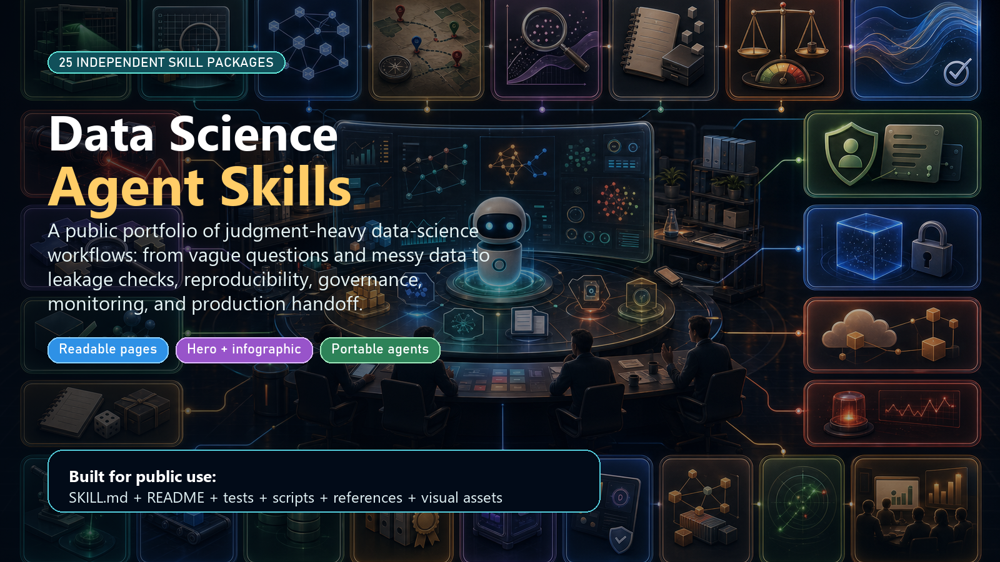
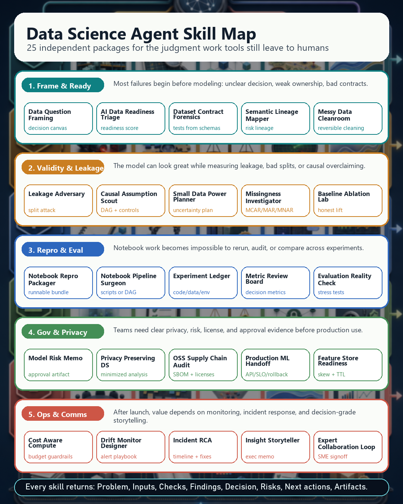
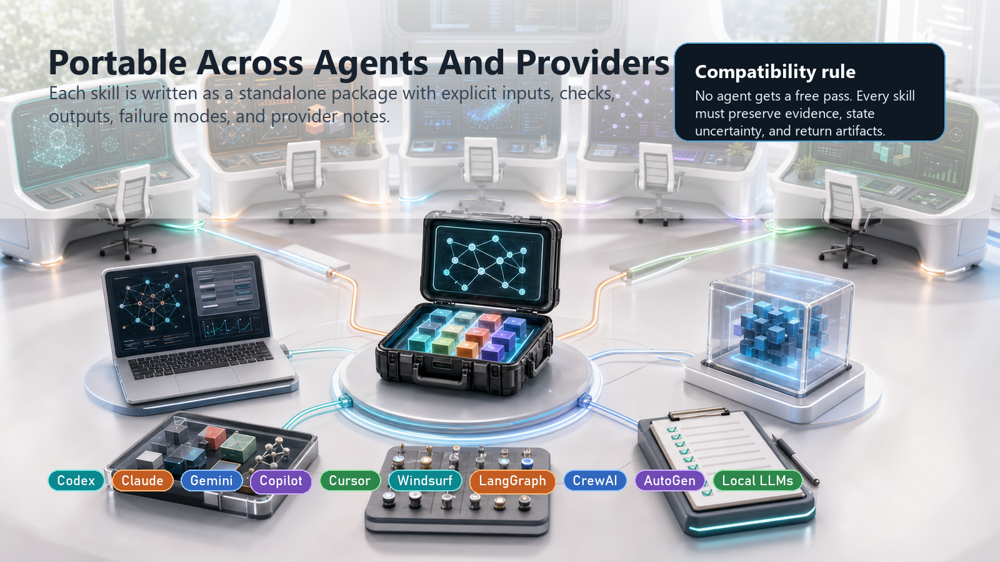

# Data Science Agent Skills



Twenty-five independent, production-grade agent skills for data science work where judgment matters: framing, readiness, data quality, leakage, reproducibility, evaluation, governance, privacy, MLOps, incident response, and stakeholder communication.

This repository is designed as a public skill catalog, not a single monolithic toolkit. Every skill lives on its own page, has its own assets, and can be copied or installed independently.

## What This Repository Gives You

- **Independent skill pages:** each folder has a public `README.md`, portable `SKILL.md`, manifest, references, scripts, tests, hero shot, and detailed infographic.
- **Agent-ready workflows:** each skill tells the agent when to use it, what evidence to request, what checks to run, and what artifact to return.
- **Provider guidance:** the skills are written to work across Codex, ChatGPT Agents, Claude, Gemini, Copilot-style agents, Cursor, Windsurf, Gravity, LangGraph, CrewAI, AutoGen, OpenHands, Goose, OpenCode, and local LLM agents.
- **Decision-grade outputs:** every skill returns the same core contract: `Problem`, `Inputs`, `Checks performed`, `Findings`, `Decision`, `Risks`, `Next actions`, and `Artifacts`.


## Pick A Skill By Pain Point

| Pain point | Start here | What the skill helps produce |
|---|---|---|
| The business question is vague or not measurable. | [Data Question Framing](data-science-agent-skills/data-question-framing/) | Decision canvas, target definition, metric tree, constraints, decision owner |
| A team wants AI before the data is ready. | [AI Data Readiness Triage](data-science-agent-skills/ai-data-readiness-triage/) | Readiness scorecard, blocker list, owner map, go/no-go recommendation |
| Schemas are messy and no practical data contract exists. | [Dataset Contract Forensics](data-science-agent-skills/dataset-contract-forensics/) | Contract draft, quality checks, Pandera/Great Expectations/dbt test suggestions |
| Nobody can explain where fields, metrics, or features came from. | [Semantic Lineage Mapper](data-science-agent-skills/semantic-lineage-mapper/) | Lineage map, dependency risk list, owner prompts, evidence ledger |
| Cleaning is happening silently and cannot be audited. | [Messy Data Cleanroom](data-science-agent-skills/messy-data-cleanroom/) | Reversible cleaning plan, mutation log, reviewable assumptions |
| A model may be leaking target, time, group, split, or join information. | [Leakage Adversary](data-science-agent-skills/leakage-adversary/) | Leakage attack report, split validation notes, contamination fixes |
| Prediction work is being sold as causal proof. | [Causal Assumption Scout](data-science-agent-skills/causal-assumption-scout/) | DAG, confounder checklist, negative controls, sensitivity plan |
| The dataset is too small for confident modeling. | [Small Data Power Planner](data-science-agent-skills/small-data-power-planner/) | Power plan, uncertainty statement, resampling/Bayesian guidance, stop rule |
| Missing values are being imputed without mechanism review. | [Missingness Mechanism Investigator](data-science-agent-skills/missingness-mechanism-investigator/) | MCAR/MAR/MNAR assessment, missingness profile, sensitivity plan |
| A notebook only works on one machine or one execution order. | [Notebook Repro Packager](data-science-agent-skills/notebook-repro-packager/) | Environment capture, data manifest, seeds, smoke test, repro checklist |
| Exploratory notebooks need to become scripts or DAG tasks. | [Notebook To Pipeline Surgeon](data-science-agent-skills/notebook-to-pipeline-surgeon/) | Refactor plan, parameter map, CLI contract, test seams, pipeline options |
| Experiments cannot be audited or compared later. | [Experiment Provenance Ledger](data-science-agent-skills/experiment-provenance-ledger/) | Code/data/env/model/metric ledger, artifact checklist, decision trace |
| Complex models are being trusted without baselines or ablations. | [Baseline Ablation Lab](data-science-agent-skills/baseline-ablation-lab/) | Baseline matrix, ablation plan, lift evidence, complexity verdict |
| Metrics are disconnected from real decisions and costs. | [Metric Design Review Board](data-science-agent-skills/metric-design-review-board/) | Metric tree, guardrails, threshold/cost curves, review verdict |
| Evaluation does not match deployment reality. | [Evaluation Reality Check](data-science-agent-skills/evaluation-reality-check/) | Split strategy, backtest plan, external validity checks, uncertainty report |
| Governance artifacts are missing before release. | [Model Risk Compliance Memo](data-science-agent-skills/model-risk-compliance-memo/) | Privacy, fairness, safety, auditability, monitoring, and approval memo |
| Sensitive data is being handled with too much exposure. | [Privacy Preserving Data Science](data-science-agent-skills/privacy-preserving-ds/) | PII discovery, minimization plan, privacy technique decision tree |
| Dependencies, notebooks, model weights, or datasets may create supply-chain risk. | [OSS Data Science Supply Chain Auditor](data-science-agent-skills/oss-ds-supply-chain-auditor/) | SBOM-style risk report, license/provenance notes, remediation plan |
| Cloud or GPU spend is running ahead of evidence. | [Cost Aware Compute Planner](data-science-agent-skills/cost-aware-compute-planner/) | Local-vs-cloud plan, sampling ladder, budget guardrails, stop rules |
| A prototype needs to be handed to engineering. | [Production ML Handoff](data-science-agent-skills/production-ml-handoff/) | API contract, artifact registry notes, rollback plan, SLOs, monitoring owners |
| Production data or model behavior may drift. | [Drift Monitor Designer](data-science-agent-skills/drift-monitor-designer/) | Drift metrics, thresholds, label-delay handling, alert/retrain playbook |
| A feature store may be useful, but could add complexity or skew. | [Feature Store Readiness](data-science-agent-skills/feature-store-readiness/) | Store-or-skip decision, feature contract, TTL, lineage, skew checks |
| A model, dashboard, or data product broke and needs RCA. | [Data Science Incident RCA](data-science-agent-skills/data-science-incident-rca/) | Timeline, blast radius, root cause, countermeasures, prevention plan |
| Analysis needs to become a decision-grade story. | [Stakeholder Insight Storyteller](data-science-agent-skills/stakeholder-insight-storyteller/) | Executive memo, visual hierarchy, uncertainty language, recommendation |
| Domain experts need to challenge agent assumptions. | [Domain Expert Collaboration Loop](data-science-agent-skills/domain-expert-collaboration-loop/) | SME interview prompts, assumption log, evidence ledger, signoff loop |

## Skill Map



The portfolio is intentionally focused on gaps that generic data-analysis tools do not solve well by themselves: judgment, provenance, readiness, leakage, domain review, governance, and operational handoff.

## How To Use A Skill

1. Open the skill folder in [`data-science-agent-skills/`](data-science-agent-skills/).
2. Read that skill's independent `README.md` to understand the problem, inputs, workflow, outputs, and validation.
3. Copy the whole skill folder into your agent's skill directory or reference the folder from your agent runtime.
4. Give the agent the relevant data, notebooks, SQL, model artifacts, stakeholder context, or incident evidence.
5. Keep the returned artifact with the project so future humans and agents can audit the decision.

## Agent And Provider Compatibility



The skills avoid provider-specific magic. They are written as portable workflows with explicit inputs, checks, final artifacts, and failure conditions.

| Provider or agent style | How to use these skills |
|---|---|
| OpenAI Codex and ChatGPT Agents | Copy the skill folder into the skills directory, then invoke the skill by name or by matching the task trigger. |
| Claude and Claude Code | Paste or install the `SKILL.md` workflow and keep the `references/`, `scripts/`, and `tests/` folders available as local context. |
| Gemini, Copilot, Cursor, Windsurf, Gravity, Goose, OpenCode, OpenHands | Treat each folder as a portable playbook: read `README.md`, follow `SKILL.md`, run deterministic scripts when available, and return the standard artifact. |
| LangGraph, CrewAI, AutoGen, LlamaIndex, Semantic Kernel | Wrap the skill as a node/tool with the declared inputs and output contract from `MANIFEST.json`. |
| Local LLM agents | Keep raw evidence local, run the included tests/scripts locally, and use the README workflow as the orchestration policy. |

Provider output is evidence, not authority. The agent should inspect local artifacts first, preserve raw evidence, avoid silent mutation, state uncertainty, and ask for user or owner confirmation when missing context would change the decision.

## What Every Independent Skill Page Includes

| File or folder | Purpose |
|---|---|
| `SKILL.md` | Portable agent instructions, trigger guidance, workflow, checks, and output contract |
| `README.md` | Public page explaining the problem, when to use the skill, inputs, workflow, examples, provider notes, and validation |
| `MANIFEST.json` | Machine-readable package metadata and contracts |
| `references/` | Playbooks, interoperability notes, research grounding, rubrics, and test guidance |
| `scripts/` | Deterministic helper scripts where the workflow benefits from repeatable checks |
| `tests/` | Contract tests plus clean, messy, and adversarial fixture coverage |
| `assets/hero-shot.png` | Skill-specific 1600x900 hero image |
| `assets/reddit-infographic.png` | Skill-specific 1080x1350 infographic with detailed workflow explanation |

## Full Independent Skill Index

| Skill | What it solves | Main artifact |
|---|---|---|
| [AI Data Readiness Triage](data-science-agent-skills/ai-data-readiness-triage/) | Scores whether data is ready for AI or analytics before modeling starts. | Readiness scorecard and blocker plan |
| [Baseline Ablation Lab](data-science-agent-skills/baseline-ablation-lab/) | Forces honest baselines and ablations before trusting complex models. | Baseline table and ablation matrix |
| [Causal Assumption Scout](data-science-agent-skills/causal-assumption-scout/) | Stops prediction work from being oversold as causal evidence. | DAG, assumption map, sensitivity notes |
| [Cost Aware Compute Planner](data-science-agent-skills/cost-aware-compute-planner/) | Prevents runaway cloud and GPU spend before experiments launch. | Compute budget plan and stop rules |
| [Data Question Framing](data-science-agent-skills/data-question-framing/) | Turns vague stakeholder asks into measurable data-science problems. | Decision canvas and metric tree |
| [Data Science Incident RCA](data-science-agent-skills/data-science-incident-rca/) | Diagnoses broken models, dashboards, data products, and pipeline incidents. | RCA memo, timeline, countermeasures |
| [Dataset Contract Forensics](data-science-agent-skills/dataset-contract-forensics/) | Infers practical data contracts and tests from messy schemas and samples. | Contract draft and test suggestions |
| [Domain Expert Collaboration Loop](data-science-agent-skills/domain-expert-collaboration-loop/) | Structures SME review so agents do not miss domain assumptions. | Assumption log and signoff trail |
| [Drift Monitor Designer](data-science-agent-skills/drift-monitor-designer/) | Designs data, concept, and performance drift monitoring with actions. | Monitoring design and alert playbook |
| [Evaluation Reality Check](data-science-agent-skills/evaluation-reality-check/) | Builds trustworthy evaluation for tabular, time-series, NLP, CV, and ranking. | Evaluation plan and stress-test report |
| [Experiment Provenance Ledger](data-science-agent-skills/experiment-provenance-ledger/) | Preserves code, data, environment, model, metrics, and decisions. | Experiment ledger and audit trail |
| [Feature Store Readiness](data-science-agent-skills/feature-store-readiness/) | Decides whether a feature store is warranted and how to design features safely. | Store-or-skip decision and feature contract |
| [Leakage Adversary](data-science-agent-skills/leakage-adversary/) | Attacks ML pipelines for target, temporal, group, split, and join leakage. | Leakage report and split validation notes |
| [Messy Data Cleanroom](data-science-agent-skills/messy-data-cleanroom/) | Produces reversible cleaning plans instead of silent data edits. | Cleaning plan and audit log |
| [Metric Design Review Board](data-science-agent-skills/metric-design-review-board/) | Aligns metrics with real decisions, costs, thresholds, and guardrails. | Metric tree and review verdict |
| [Missingness Mechanism Investigator](data-science-agent-skills/missingness-mechanism-investigator/) | Diagnoses MCAR, MAR, MNAR, or unknown missingness before imputation. | Missingness report and sensitivity plan |
| [Model Risk Compliance Memo](data-science-agent-skills/model-risk-compliance-memo/) | Creates governance-ready artifacts for privacy, fairness, safety, auditability, and monitoring. | Model risk memo and conditions |
| [Notebook Repro Packager](data-science-agent-skills/notebook-repro-packager/) | Makes notebooks runnable elsewhere with environment, seeds, data manifest, and smoke tests. | Repro package and smoke test |
| [Notebook To Pipeline Surgeon](data-science-agent-skills/notebook-to-pipeline-surgeon/) | Refactors exploratory notebooks into modular scripts or DAG tasks. | Pipeline extraction plan and CLI contract |
| [OSS Data Science Supply Chain Auditor](data-science-agent-skills/oss-ds-supply-chain-auditor/) | Audits dependencies, notebooks, model weights, datasets, licenses, and provenance. | SBOM-style risk report |
| [Privacy Preserving Data Science](data-science-agent-skills/privacy-preserving-ds/) | Guides minimized, local-first, aggregated, synthetic, federated, or enclave analysis. | Privacy decision tree and safe-analysis plan |
| [Production ML Handoff](data-science-agent-skills/production-ml-handoff/) | Turns data-science prototypes into engineering-ready production handoffs. | Handoff packet, API contract, monitoring plan |
| [Semantic Lineage Mapper](data-science-agent-skills/semantic-lineage-mapper/) | Reconstructs lineage from SQL, notebooks, pipelines, configs, and dashboards. | Lineage map and owner prompts |
| [Small Data Power Planner](data-science-agent-skills/small-data-power-planner/) | Helps teams avoid overfitting, false certainty, and premature modeling with scarce data. | Power plan, uncertainty summary, stop rule |
| [Stakeholder Insight Storyteller](data-science-agent-skills/stakeholder-insight-storyteller/) | Converts analysis into decision-grade narrative without overclaiming. | Executive memo and recommendation narrative |

## Validation

Run the contract checks inside any skill folder:

```bash
python scripts/quick_validate_skill.py . --strict
python tests/test_skill_contract.py .
```

For the full repository, repeat those checks across all folders in `data-science-agent-skills/`.
