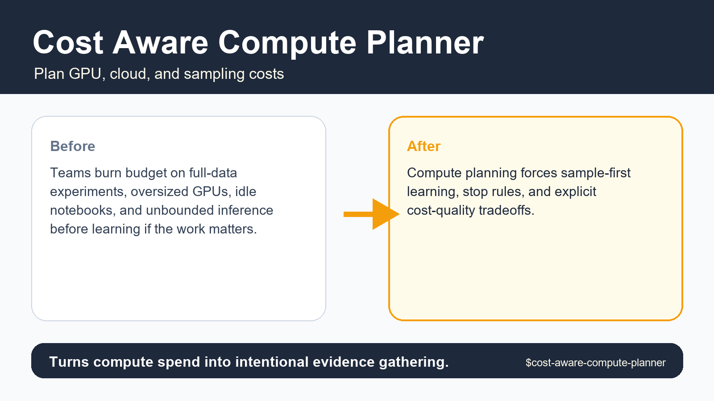
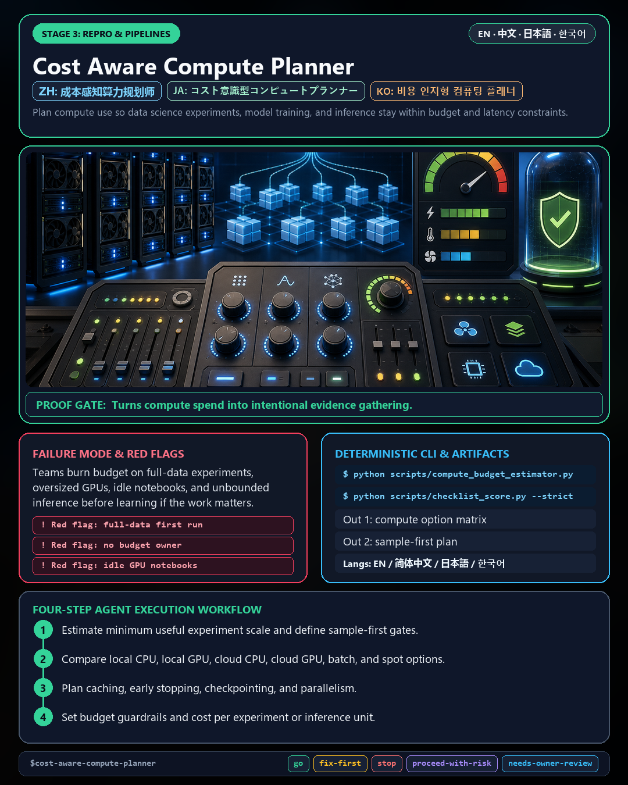

# Cost Aware Compute Planner





## Executive Summary

**Cost Aware Compute Planner** is a portable, provider-neutral data science agent skill designed to plan compute use so data science experiments, model training, and inference stay within budget and latency constraints.

> **Core pain solved:** Teams burn budget on full-data experiments, oversized GPUs, idle notebooks, and unbounded inference before learning if the work matters.

> **Proof callout:** Turns compute spend into intentional evidence gathering.

## Research-Informed Design Standard

This skill follows reproducible data science and portable agent-skill standards:

- **Cookiecutter Data Science**: immutable raw data, clear artifact layout, and repeatable command entrypoints.
- **Kedro**: explicit input/output data contracts and modular workflow boundaries.
- **MLflow**: traceable parameters, metrics, provenance hashes, and governance-ready evaluation records.
- **Anthropic & Open Agent Skills**: concise `SKILL.md` frontmatter, progressive disclosure via `references/`, and deterministic local scripts in `scripts/`.
- **CfRR Reproducible Research**: deterministic verification, explicit uncertainty, and zero hidden state.

## Problem It Solves

Teams burn budget on full-data experiments, oversized GPUs, idle notebooks, and unbounded inference before learning if the work matters. Without a structured gate, teams routinely discover `full-data first run` or `no budget owner` only after engineering effort or executive credibility has already been spent.

## What This Skill Should Do

- Transform a vague request into an explicit Cost Aware Compute Planner decision with named owner, evidence, assumptions, and action threshold.
- Inspect local artifacts first: data extracts, schemas, notebooks, SQL, pipeline configs, model reports, tickets, and prior decisions.
- Separate mechanical checks from expert judgment so another reviewer can reproduce what was checked and what was inferred.
- Classify findings as stop, fix-first, monitor, accepted risk, or owner decision instead of producing generic advice.
- Preserve raw evidence and never silently mutate data, notebooks, model artifacts, or production configs.
- Return a decision artifact that can be handed to a data scientist, ML engineer, governance reviewer, or stakeholder without hidden context.

## Required Inputs

- task type
- data size
- model candidates
- cloud or local options
- budget
- deadline
- latency needs

## Operating Workflow

1. Estimate minimum useful experiment scale and define sample-first gates.
2. Compare local CPU, local GPU, cloud CPU, cloud GPU, batch, and spot options.
3. Plan caching, early stopping, checkpointing, and parallelism.
4. Set budget guardrails and cost per experiment or inference unit.
5. Return a compute plan with stop rules and escalation thresholds.

## Expected Outputs

- compute option matrix
- sample-first plan
- budget guardrails
- stop rules
- cost-risk memo

All outputs are delivered inside the eight-section decision contract: `Problem`, `Inputs`, `Checks performed`, `Findings`, `Decision`, `Risks`, `Next actions`, and `Artifacts`.

## Concrete Use Cases

- **Pre-commit readiness gate**: Run `scripts/compute_budget_estimator.py` on `task type` to produce a `compute option matrix` before approving engineering scope.
- **Adversarial review**: Challenge a proposed `go` recommendation when `full-data first run` or `no budget owner` is suspected in `data size`.
- **Cross-team handoff**: Generate `sample-first plan` and `cost-risk memo` so ML engineers, governance reviewers, or downstream agents can act without re-running discovery.
- **Regression audit**: Score completed review checklists with `scripts/checklist_score.py --strict` inside CI to prevent unverified artifacts from shipping.

## Red Flags

- full-data first run
- no budget owner
- idle GPU notebooks
- inference cost ignored
- training cheaper than monitoring is assumed

## Agent And Provider Portability

- **Agent Runtimes**: OpenAI Codex, ChatGPT Agents, Anthropic Claude, Claude Code, Google Gemini, GitHub Copilot, Cursor, Windsurf, Goose, OpenCode, OpenHands, Gravity, LangGraph, CrewAI, AutoGen, LlamaIndex, Semantic Kernel, and local LLM agents.
- **Data & ML Providers**: Snowflake, BigQuery, Databricks, Postgres, dbt, Dagster, Airflow, Prefect, MLflow, DVC, Weights & Biases, SageMaker, Vertex AI, Azure ML, Great Expectations, Pandera, Evidently, Kedro, and local CSV/Parquet/JSON files.

See [references/agent-portability.md](references/agent-portability.md) and [references/provider-interop.md](references/provider-interop.md) for host-specific integration instructions.

## Included Files

- `SKILL.md`
- `README.md`
- `MANIFEST.json`
- `AGENTS.md`
- `agents/openai.yaml`
- `scripts/compute_budget_estimator.py`
- `scripts/checklist_score.py`
- `scripts/quick_validate_skill.py`
- `references/multilingual-guide.md`: Native English, Simplified Chinese (简体中文), Japanese (日本語), and Korean (한국어) execution guide.
- `references/playbook.md`
- `references/acceptance-tests.md`
- `references/provider-interop.md`
- `references/agent-portability.md`
- `references/quality-rubric.md`
- `references/benchmark-plan.md`
- `references/research-grounding.md`
- `references/evidence-map.md`
- `references/infographic-spec.md`
- `tests/test_skill_contract.py`
- `tests/fixtures/clean.md`
- `tests/fixtures/messy.md`
- `tests/fixtures/adversarial.md`
- `assets/hero-shot.png`
- `assets/reddit-infographic.png`

## Validation

Run the deterministic smoke and contract suite from inside this skill directory:

```bash
python scripts/compute_budget_estimator.py --hours 4 --hourly-rate 3.5 --runs 6 --failure-rate 0.15 --budget 100
python scripts/quick_validate_skill.py . --strict
python tests/test_skill_contract.py .
```

## Visual Assets

- Hero shot (`1600x900`): [assets/hero-shot.png](assets/hero-shot.png) (`https://raw.githubusercontent.com/Emily2040/data-science-agent-skills/main/data-science-agent-skills/cost-aware-compute-planner/assets/hero-shot.png`)
- Reddit infographic (`1080x1350`): [assets/reddit-infographic.png](assets/reddit-infographic.png) (`https://raw.githubusercontent.com/Emily2040/data-science-agent-skills/main/data-science-agent-skills/cost-aware-compute-planner/assets/reddit-infographic.png`)
