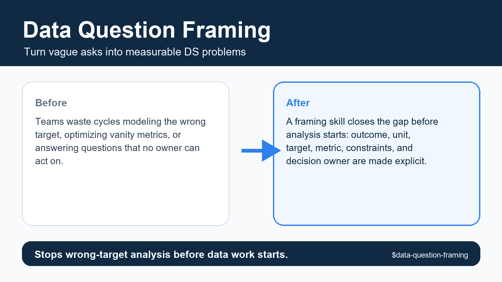
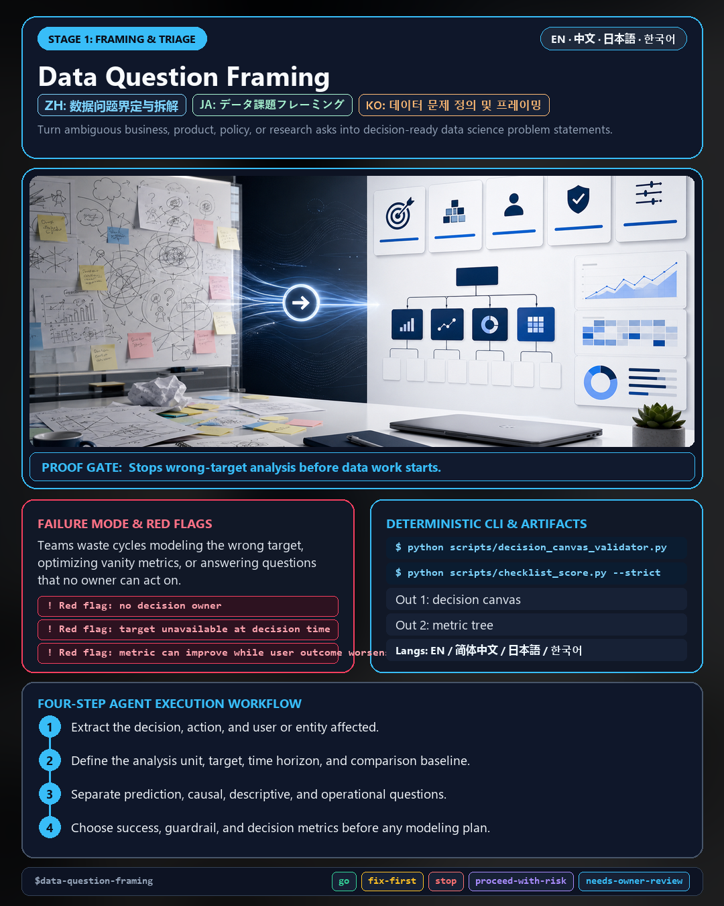

# Data Question Framing





## Executive Summary

**Data Question Framing** is a portable, provider-neutral data science agent skill designed to turn ambiguous business, product, policy, or research asks into decision-ready data science problem statements.

> **Core pain solved:** Teams waste cycles modeling the wrong target, optimizing vanity metrics, or answering questions that no owner can act on.

> **Proof callout:** Stops wrong-target analysis before data work starts.

## Research-Informed Design Standard

This skill follows reproducible data science and portable agent-skill standards:

- **Cookiecutter Data Science**: immutable raw data, clear artifact layout, and repeatable command entrypoints.
- **Kedro**: explicit input/output data contracts and modular workflow boundaries.
- **MLflow**: traceable parameters, metrics, provenance hashes, and governance-ready evaluation records.
- **Anthropic & Open Agent Skills**: concise `SKILL.md` frontmatter, progressive disclosure via `references/`, and deterministic local scripts in `scripts/`.
- **CfRR Reproducible Research**: deterministic verification, explicit uncertainty, and zero hidden state.

## Problem It Solves

Teams waste cycles modeling the wrong target, optimizing vanity metrics, or answering questions that no owner can act on. Without a structured gate, teams routinely discover `no decision owner` or `target unavailable at decision time` only after engineering effort or executive credibility has already been spent.

## What This Skill Should Do

- Transform a vague request into an explicit Data Question Framing decision with named owner, evidence, assumptions, and action threshold.
- Inspect local artifacts first: data extracts, schemas, notebooks, SQL, pipeline configs, model reports, tickets, and prior decisions.
- Separate mechanical checks from expert judgment so another reviewer can reproduce what was checked and what was inferred.
- Classify findings as stop, fix-first, monitor, accepted risk, or owner decision instead of producing generic advice.
- Preserve raw evidence and never silently mutate data, notebooks, model artifacts, or production configs.
- Return a decision artifact that can be handed to a data scientist, ML engineer, governance reviewer, or stakeholder without hidden context.

## Required Inputs

- raw stakeholder request
- available decision or business context
- known data sources or constraints
- deadline and decision owner

## Operating Workflow

1. Extract the decision, action, and user or entity affected.
2. Define the analysis unit, target, time horizon, and comparison baseline.
3. Separate prediction, causal, descriptive, and operational questions.
4. Choose success, guardrail, and decision metrics before any modeling plan.
5. Return a decision canvas with assumptions and unresolved questions.

## Expected Outputs

- decision canvas
- metric tree
- assumption log
- scope boundaries
- next evidence needed

All outputs are delivered inside the eight-section decision contract: `Problem`, `Inputs`, `Checks performed`, `Findings`, `Decision`, `Risks`, `Next actions`, and `Artifacts`.

## Concrete Use Cases

- **Pre-commit readiness gate**: Run `scripts/decision_canvas_validator.py` on `raw stakeholder request` to produce a `decision canvas` before approving engineering scope.
- **Adversarial review**: Challenge a proposed `go` recommendation when `no decision owner` or `target unavailable at decision time` is suspected in `available decision or business context`.
- **Cross-team handoff**: Generate `metric tree` and `next evidence needed` so ML engineers, governance reviewers, or downstream agents can act without re-running discovery.
- **Regression audit**: Score completed review checklists with `scripts/checklist_score.py --strict` inside CI to prevent unverified artifacts from shipping.

## Red Flags

- no decision owner
- target unavailable at decision time
- metric can improve while user outcome worsens
- causal claim hidden inside prediction wording

## Agent And Provider Portability

- **Agent Runtimes**: OpenAI Codex, ChatGPT Agents, Anthropic Claude, Claude Code, Google Gemini, GitHub Copilot, Cursor, Windsurf, Goose, OpenCode, OpenHands, Gravity, LangGraph, CrewAI, AutoGen, LlamaIndex, Semantic Kernel, and local LLM agents.
- **Data & ML Providers**: Snowflake, BigQuery, Databricks, Postgres, dbt, Dagster, Airflow, Prefect, MLflow, DVC, Weights & Biases, SageMaker, Vertex AI, Azure ML, Great Expectations, Pandera, Evidently, Kedro, and local CSV/Parquet/JSON files.

See [references/agent-portability.md](references/agent-portability.md) and [references/provider-interop.md](references/provider-interop.md) for host-specific integration instructions.

## Included Files

- `SKILL.md`
- `README.md`
- `MANIFEST.json`
- `AGENTS.md`
- `agents/openai.yaml`
- `scripts/decision_canvas_validator.py`
- `scripts/checklist_score.py`
- `scripts/quick_validate_skill.py`
- `references/multilingual-guide.md`: Native English, Simplified Chinese (简体中文), Japanese (日本語), and Korean (한국어) execution guide.
- `references/playbook.md`
- `references/acceptance-tests.md`
- `references/provider-interop.md`
- `references/agent-portability.md`
- `references/quality-rubric.md`
- `references/benchmark-plan.md`
- `references/research-grounding.md`
- `references/evidence-map.md`
- `references/infographic-spec.md`
- `tests/test_skill_contract.py`
- `tests/fixtures/clean.md`
- `tests/fixtures/messy.md`
- `tests/fixtures/adversarial.md`
- `assets/hero-shot.png`
- `assets/reddit-infographic.png`

## Validation

Run the deterministic smoke and contract suite from inside this skill directory:

```bash
python scripts/decision_canvas_validator.py path/to/decision_canvas.json
python scripts/quick_validate_skill.py . --strict
python tests/test_skill_contract.py .
```

## Visual Assets

- Hero shot (`1600x900`): [assets/hero-shot.png](assets/hero-shot.png) (`https://raw.githubusercontent.com/Emily2040/data-science-agent-skills/main/data-science-agent-skills/data-question-framing/assets/hero-shot.png`)
- Reddit infographic (`1080x1350`): [assets/reddit-infographic.png](assets/reddit-infographic.png) (`https://raw.githubusercontent.com/Emily2040/data-science-agent-skills/main/data-science-agent-skills/data-question-framing/assets/reddit-infographic.png`)
