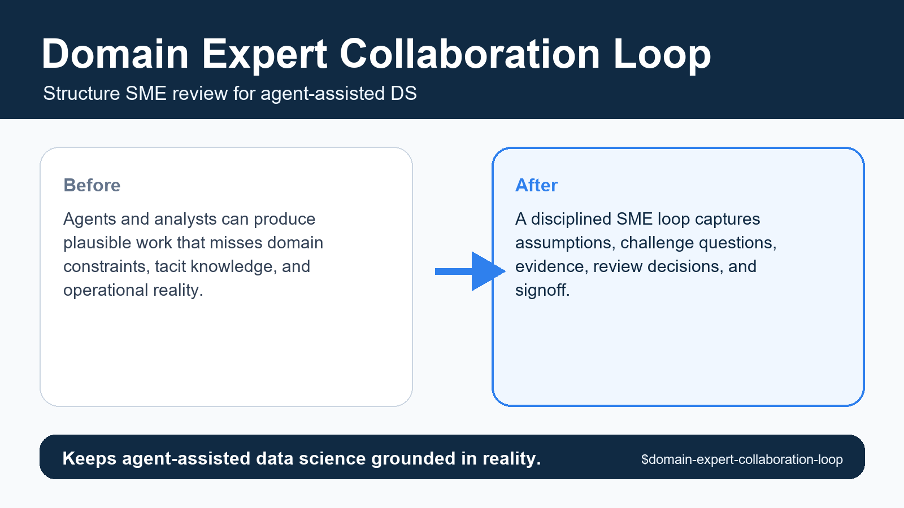
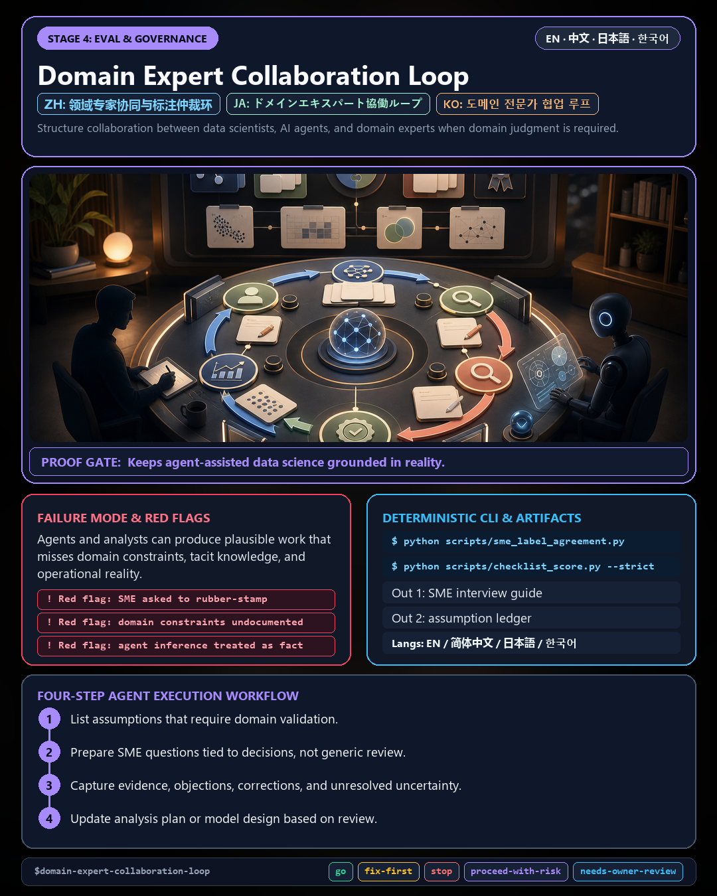

# Domain Expert Collaboration Loop





## Executive Summary

**Domain Expert Collaboration Loop** is a portable, provider-neutral data science agent skill designed to structure collaboration between data scientists, AI agents, and domain experts when domain judgment is required.

> **Core pain solved:** Agents and analysts can produce plausible work that misses domain constraints, tacit knowledge, and operational reality.

> **Proof callout:** Keeps agent-assisted data science grounded in reality.

## Research-Informed Design Standard

This skill follows reproducible data science and portable agent-skill standards:

- **Cookiecutter Data Science**: immutable raw data, clear artifact layout, and repeatable command entrypoints.
- **Kedro**: explicit input/output data contracts and modular workflow boundaries.
- **MLflow**: traceable parameters, metrics, provenance hashes, and governance-ready evaluation records.
- **Anthropic & Open Agent Skills**: concise `SKILL.md` frontmatter, progressive disclosure via `references/`, and deterministic local scripts in `scripts/`.
- **CfRR Reproducible Research**: deterministic verification, explicit uncertainty, and zero hidden state.

## Problem It Solves

Agents and analysts can produce plausible work that misses domain constraints, tacit knowledge, and operational reality. Without a structured gate, teams routinely discover `SME asked to rubber-stamp` or `domain constraints undocumented` only after engineering effort or executive credibility has already been spent.

## What This Skill Should Do

- Transform a vague request into an explicit Domain Expert Collaboration Loop decision with named owner, evidence, assumptions, and action threshold.
- Inspect local artifacts first: data extracts, schemas, notebooks, SQL, pipeline configs, model reports, tickets, and prior decisions.
- Separate mechanical checks from expert judgment so another reviewer can reproduce what was checked and what was inferred.
- Classify findings as stop, fix-first, monitor, accepted risk, or owner decision instead of producing generic advice.
- Preserve raw evidence and never silently mutate data, notebooks, model artifacts, or production configs.
- Return a decision artifact that can be handed to a data scientist, ML engineer, governance reviewer, or stakeholder without hidden context.

## Required Inputs

- analysis or model plan
- domain experts
- known constraints
- critical assumptions
- review deadline
- decision owner

## Operating Workflow

1. List assumptions that require domain validation.
2. Prepare SME questions tied to decisions, not generic review.
3. Capture evidence, objections, corrections, and unresolved uncertainty.
4. Update analysis plan or model design based on review.
5. Return an assumption ledger and signoff record.

## Expected Outputs

- SME interview guide
- assumption ledger
- challenge-question list
- evidence log
- signoff and open-risk record

All outputs are delivered inside the eight-section decision contract: `Problem`, `Inputs`, `Checks performed`, `Findings`, `Decision`, `Risks`, `Next actions`, and `Artifacts`.

## Concrete Use Cases

- **Pre-commit readiness gate**: Run `scripts/sme_label_agreement.py` on `analysis or model plan` to produce a `SME interview guide` before approving engineering scope.
- **Adversarial review**: Challenge a proposed `go` recommendation when `SME asked to rubber-stamp` or `domain constraints undocumented` is suspected in `domain experts`.
- **Cross-team handoff**: Generate `assumption ledger` and `signoff and open-risk record` so ML engineers, governance reviewers, or downstream agents can act without re-running discovery.
- **Regression audit**: Score completed review checklists with `scripts/checklist_score.py --strict` inside CI to prevent unverified artifacts from shipping.

## Red Flags

- SME asked to rubber-stamp
- domain constraints undocumented
- agent inference treated as fact
- feedback not linked to changes
- signoff missing

## Agent And Provider Portability

- **Agent Runtimes**: OpenAI Codex, ChatGPT Agents, Anthropic Claude, Claude Code, Google Gemini, GitHub Copilot, Cursor, Windsurf, Goose, OpenCode, OpenHands, Gravity, LangGraph, CrewAI, AutoGen, LlamaIndex, Semantic Kernel, and local LLM agents.
- **Data & ML Providers**: Snowflake, BigQuery, Databricks, Postgres, dbt, Dagster, Airflow, Prefect, MLflow, DVC, Weights & Biases, SageMaker, Vertex AI, Azure ML, Great Expectations, Pandera, Evidently, Kedro, and local CSV/Parquet/JSON files.

See [references/agent-portability.md](references/agent-portability.md) and [references/provider-interop.md](references/provider-interop.md) for host-specific integration instructions.

## Included Files

- `SKILL.md`
- `README.md`
- `MANIFEST.json`
- `AGENTS.md`
- `agents/openai.yaml`
- `scripts/sme_label_agreement.py`
- `scripts/checklist_score.py`
- `scripts/quick_validate_skill.py`
- `references/multilingual-guide.md`: Native English, Simplified Chinese (简体中文), Japanese (日本語), and Korean (한국어) execution guide.
- `references/playbook.md`
- `references/acceptance-tests.md`
- `references/provider-interop.md`
- `references/agent-portability.md`
- `references/quality-rubric.md`
- `references/benchmark-plan.md`
- `references/research-grounding.md`
- `references/evidence-map.md`
- `references/infographic-spec.md`
- `tests/test_skill_contract.py`
- `tests/fixtures/clean.md`
- `tests/fixtures/messy.md`
- `tests/fixtures/adversarial.md`
- `assets/hero-shot.png`
- `assets/reddit-infographic.png`

## Validation

Run the deterministic smoke and contract suite from inside this skill directory:

```bash
python scripts/sme_label_agreement.py path/to/sme_labels.csv --rater-a sme_a --rater-b sme_b
python scripts/quick_validate_skill.py . --strict
python tests/test_skill_contract.py .
```

## Visual Assets

- Hero shot (`1600x900`): [assets/hero-shot.png](assets/hero-shot.png) (`https://raw.githubusercontent.com/Emily2040/data-science-agent-skills/main/data-science-agent-skills/domain-expert-collaboration-loop/assets/hero-shot.png`)
- Reddit infographic (`1080x1350`): [assets/reddit-infographic.png](assets/reddit-infographic.png) (`https://raw.githubusercontent.com/Emily2040/data-science-agent-skills/main/data-science-agent-skills/domain-expert-collaboration-loop/assets/reddit-infographic.png`)
