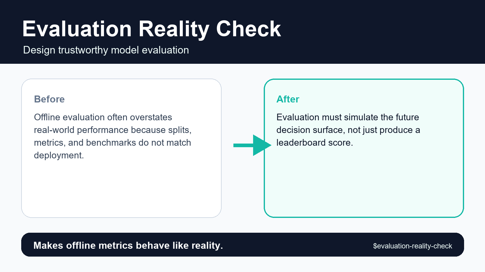
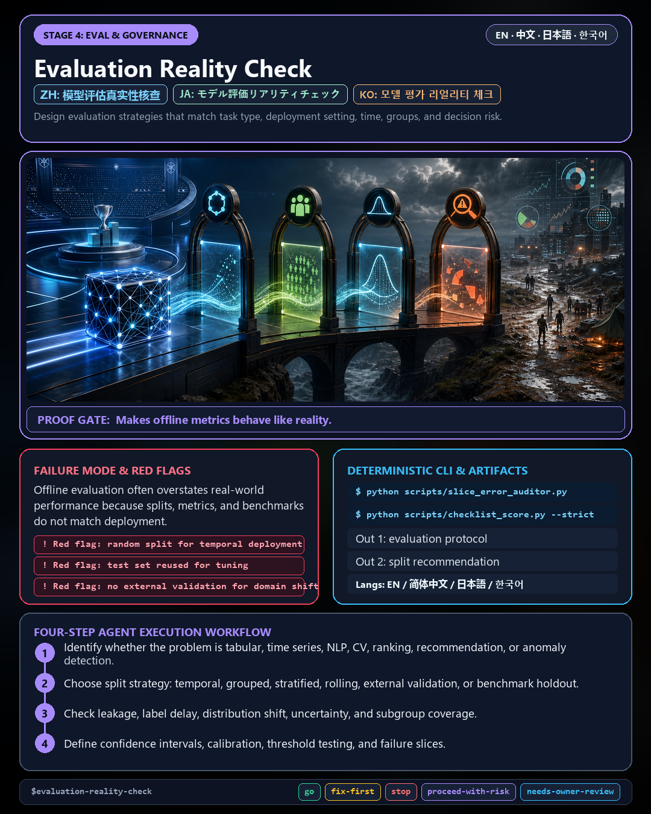

# Evaluation Reality Check





## Executive Summary

**Evaluation Reality Check** is a portable, provider-neutral data science agent skill designed to design evaluation strategies that match task type, deployment setting, time, groups, and decision risk.

> **Core pain solved:** Offline evaluation often overstates real-world performance because splits, metrics, and benchmarks do not match deployment.

> **Proof callout:** Makes offline metrics behave like reality.

## Research-Informed Design Standard

This skill follows reproducible data science and portable agent-skill standards:

- **Cookiecutter Data Science**: immutable raw data, clear artifact layout, and repeatable command entrypoints.
- **Kedro**: explicit input/output data contracts and modular workflow boundaries.
- **MLflow**: traceable parameters, metrics, provenance hashes, and governance-ready evaluation records.
- **Anthropic & Open Agent Skills**: concise `SKILL.md` frontmatter, progressive disclosure via `references/`, and deterministic local scripts in `scripts/`.
- **CfRR Reproducible Research**: deterministic verification, explicit uncertainty, and zero hidden state.

## Problem It Solves

Offline evaluation often overstates real-world performance because splits, metrics, and benchmarks do not match deployment. Without a structured gate, teams routinely discover `random split for temporal deployment` or `test set reused for tuning` only after engineering effort or executive credibility has already been spent.

## What This Skill Should Do

- Transform a vague request into an explicit Evaluation Reality Check decision with named owner, evidence, assumptions, and action threshold.
- Inspect local artifacts first: data extracts, schemas, notebooks, SQL, pipeline configs, model reports, tickets, and prior decisions.
- Separate mechanical checks from expert judgment so another reviewer can reproduce what was checked and what was inferred.
- Classify findings as stop, fix-first, monitor, accepted risk, or owner decision instead of producing generic advice.
- Preserve raw evidence and never silently mutate data, notebooks, model artifacts, or production configs.
- Return a decision artifact that can be handed to a data scientist, ML engineer, governance reviewer, or stakeholder without hidden context.

## Required Inputs

- task type
- data generation process
- deployment use
- target and features
- metric
- risk level

## Operating Workflow

1. Identify whether the problem is tabular, time series, NLP, CV, ranking, recommendation, or anomaly detection.
2. Choose split strategy: temporal, grouped, stratified, rolling, external validation, or benchmark holdout.
3. Check leakage, label delay, distribution shift, uncertainty, and subgroup coverage.
4. Define confidence intervals, calibration, threshold testing, and failure slices.
5. Return an evaluation protocol and minimum launch evidence.

## Expected Outputs

- evaluation protocol
- split recommendation
- failure-slice plan
- uncertainty report
- launch evidence checklist

All outputs are delivered inside the eight-section decision contract: `Problem`, `Inputs`, `Checks performed`, `Findings`, `Decision`, `Risks`, `Next actions`, and `Artifacts`.

## Concrete Use Cases

- **Pre-commit readiness gate**: Run `scripts/slice_error_auditor.py` on `task type` to produce a `evaluation protocol` before approving engineering scope.
- **Adversarial review**: Challenge a proposed `go` recommendation when `random split for temporal deployment` or `test set reused for tuning` is suspected in `data generation process`.
- **Cross-team handoff**: Generate `split recommendation` and `launch evidence checklist` so ML engineers, governance reviewers, or downstream agents can act without re-running discovery.
- **Regression audit**: Score completed review checklists with `scripts/checklist_score.py --strict` inside CI to prevent unverified artifacts from shipping.

## Red Flags

- random split for temporal deployment
- test set reused for tuning
- no external validation for domain shift
- single aggregate metric
- label delay ignored

## Agent And Provider Portability

- **Agent Runtimes**: OpenAI Codex, ChatGPT Agents, Anthropic Claude, Claude Code, Google Gemini, GitHub Copilot, Cursor, Windsurf, Goose, OpenCode, OpenHands, Gravity, LangGraph, CrewAI, AutoGen, LlamaIndex, Semantic Kernel, and local LLM agents.
- **Data & ML Providers**: Snowflake, BigQuery, Databricks, Postgres, dbt, Dagster, Airflow, Prefect, MLflow, DVC, Weights & Biases, SageMaker, Vertex AI, Azure ML, Great Expectations, Pandera, Evidently, Kedro, and local CSV/Parquet/JSON files.

See [references/agent-portability.md](references/agent-portability.md) and [references/provider-interop.md](references/provider-interop.md) for host-specific integration instructions.

## Included Files

- `SKILL.md`
- `README.md`
- `MANIFEST.json`
- `AGENTS.md`
- `agents/openai.yaml`
- `scripts/slice_error_auditor.py`
- `scripts/checklist_score.py`
- `scripts/quick_validate_skill.py`
- `references/multilingual-guide.md`: Native English, Simplified Chinese (简体中文), Japanese (日本語), and Korean (한국어) execution guide.
- `references/playbook.md`
- `references/acceptance-tests.md`
- `references/provider-interop.md`
- `references/agent-portability.md`
- `references/quality-rubric.md`
- `references/benchmark-plan.md`
- `references/research-grounding.md`
- `references/evidence-map.md`
- `references/infographic-spec.md`
- `tests/test_skill_contract.py`
- `tests/fixtures/clean.md`
- `tests/fixtures/messy.md`
- `tests/fixtures/adversarial.md`
- `assets/hero-shot.png`
- `assets/reddit-infographic.png`

## Validation

Run the deterministic smoke and contract suite from inside this skill directory:

```bash
python scripts/slice_error_auditor.py path/to/predictions.csv --max-slice-gap 0.10
python scripts/quick_validate_skill.py . --strict
python tests/test_skill_contract.py .
```

## Visual Assets

- Hero shot (`1600x900`): [assets/hero-shot.png](assets/hero-shot.png) (`https://raw.githubusercontent.com/Emily2040/data-science-agent-skills/main/data-science-agent-skills/evaluation-reality-check/assets/hero-shot.png`)
- Reddit infographic (`1080x1350`): [assets/reddit-infographic.png](assets/reddit-infographic.png) (`https://raw.githubusercontent.com/Emily2040/data-science-agent-skills/main/data-science-agent-skills/evaluation-reality-check/assets/reddit-infographic.png`)
