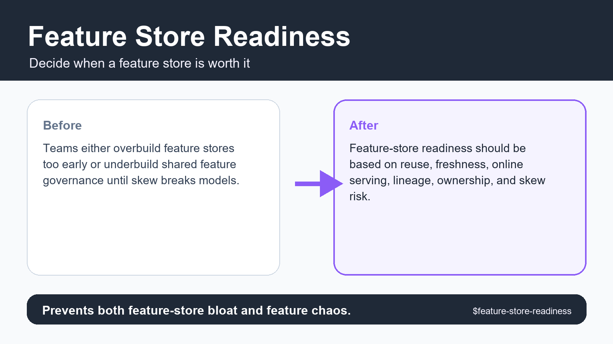
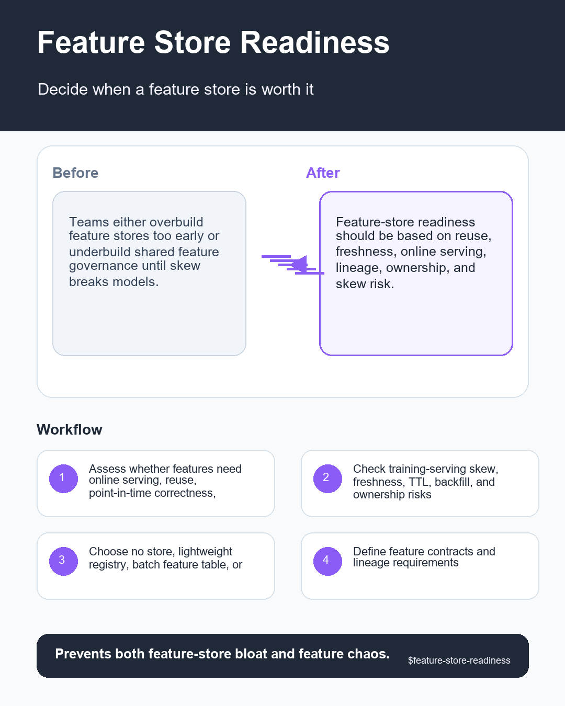

# Feature Store Readiness

## What This Skill Solves

Decide whether a feature store is needed and design features to avoid training-serving skew, staleness, and reuse confusion.

Pain point: Teams either overbuild feature stores too early or underbuild shared feature governance until skew breaks models.

Why it matters: Feature-store readiness should be based on reuse, freshness, online serving, lineage, ownership, and skew risk.

## When To Use It

Use `$feature-store-readiness` when the task is to decide whether a feature store is needed and design features to avoid training-serving skew, staleness, and reuse confusion. It is built for judgment-heavy work where the agent must inspect evidence, name assumptions, and produce a decision-ready artifact.

## When Not To Use It

- Do not use this skill for generic spreadsheet editing, chart styling, or file conversion unless the data science decision workflow is the main task.
- Do not use it as a substitute for legal, medical, financial, or compliance approval.
- Do not use helper scripts as proof by themselves; scripts provide evidence checks, not full expert judgment.

## Inputs

- feature list
- training data flow
- serving flow
- latency needs
- reuse demand
- ownership model

## Workflow

1. Assess whether features need online serving, reuse, point-in-time correctness, or shared governance.
2. Check training-serving skew, freshness, TTL, backfill, and ownership risks.
3. Recommend no store, lightweight registry, batch feature table, or full feature store.
4. Define feature contracts and lineage requirements.
5. Return a readiness decision and migration plan.

## Outputs

- feature-store decision
- skew risk table
- feature contract outline
- TTL and freshness plan
- migration steps

Every final response should include: Problem, Inputs, Checks performed, Findings, Decision, Risks, Next actions, and Artifacts.

## Use With Other Agents And Providers

### OpenAI Codex Or ChatGPT Agents

Copy this whole folder into the configured skills directory. Invoke it with `$feature-store-readiness` or let the frontmatter description trigger it. Keep `references/`, `scripts/`, and `assets/` beside `SKILL.md`.

### Anthropic Claude Skills

Use manual adaptation unless the host supports multi-file skill folders directly. Use `SKILL.md` as the primary skill instruction. Keep `references/playbook.md` and `references/acceptance-tests.md` attached as supporting resources when possible.

### Cursor, Windsurf, GitHub Copilot, And IDE Agents

Use manual adaptation. Attach `SKILL.md` as the task rule. Attach `references/playbook.md` for review or implementation work, and run helper scripts locally when file evidence is available.

### LangGraph, CrewAI, AutoGen, And Custom Runtimes

Use manual adaptation. Treat this folder as a specialist-agent role pack. Expose scripts in `scripts/` as local tools and route results through the standard output contract.

### Data Providers And Platforms

Use local exports or metadata from Snowflake, BigQuery, Databricks, Postgres, dbt, Dagster, MLflow, DVC, W&B, SageMaker, Vertex AI, Azure ML, or local files. Do not upload private data to external providers unless the user explicitly approves that environment.

## Included Files

- `SKILL.md`: trigger metadata and core workflow.
- `agents/openai.yaml`: OpenAI UI metadata and invocation defaults.
- `.gitignore`: keeps Python bytecode caches and local OS files out of PR payloads.
- `references/playbook.md`: checklist, decision rules, red flags, and evidence discipline.
- `references/acceptance-tests.md`: clean, messy, and adversarial forward tests.
- `references/evidence-map.md`: public evidence and non-duplication rationale.
- `references/infographic-spec.md`: Reddit visual brief.
- `references/provider-interop.md`: provider and agent usage guide.
- `scripts/`: deterministic local helper scripts.
- `assets/hero-shot.png`: wide hero image for PRs and docs.
- `assets/reddit-infographic.png`: 1080x1350 Reddit-ready infographic.

## Helper Scripts

Run scripts locally against explicit user-provided artifacts. They are support checks, not complete replacements for expert review.

- `scripts/quick_validate_skill.py .`: validate this standalone skill folder. Exit `0` means the package is structurally complete.
- `scripts/checklist_score.py checklist.json --strict`: score pass/partial/fail/blocker checklist JSON. Exit nonzero when strict mode finds anything below ready.

## Red Flags

- same feature computed differently online
- freshness unknown
- no point-in-time join
- feature owner unclear
- feature store proposed without reuse

## Validation

Run `python scripts/quick_validate_skill.py .` inside this folder. For script-backed checks, run the relevant script on local fixture data or user-provided artifacts. Validate the result against `references/acceptance-tests.md`.

## Completeness Checklist

- [x] Independent `SKILL.md` with specific trigger metadata.
- [x] README page with problem, use cases, inputs, workflow, outputs, provider guidance, and validation.
- [x] Provider and multi-agent interoperability guide.
- [x] Skill-specific playbook and acceptance tests.
- [x] Hero shot and Reddit infographic assets.
- [x] Local deterministic helper scripts where useful.
- [x] Explicit red flags and evidence discipline.
