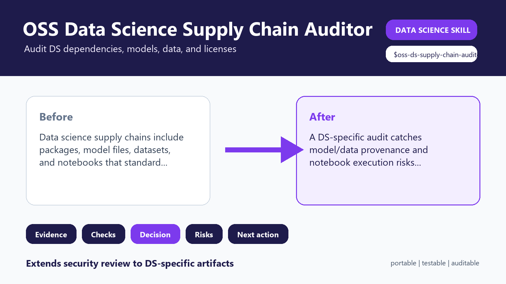
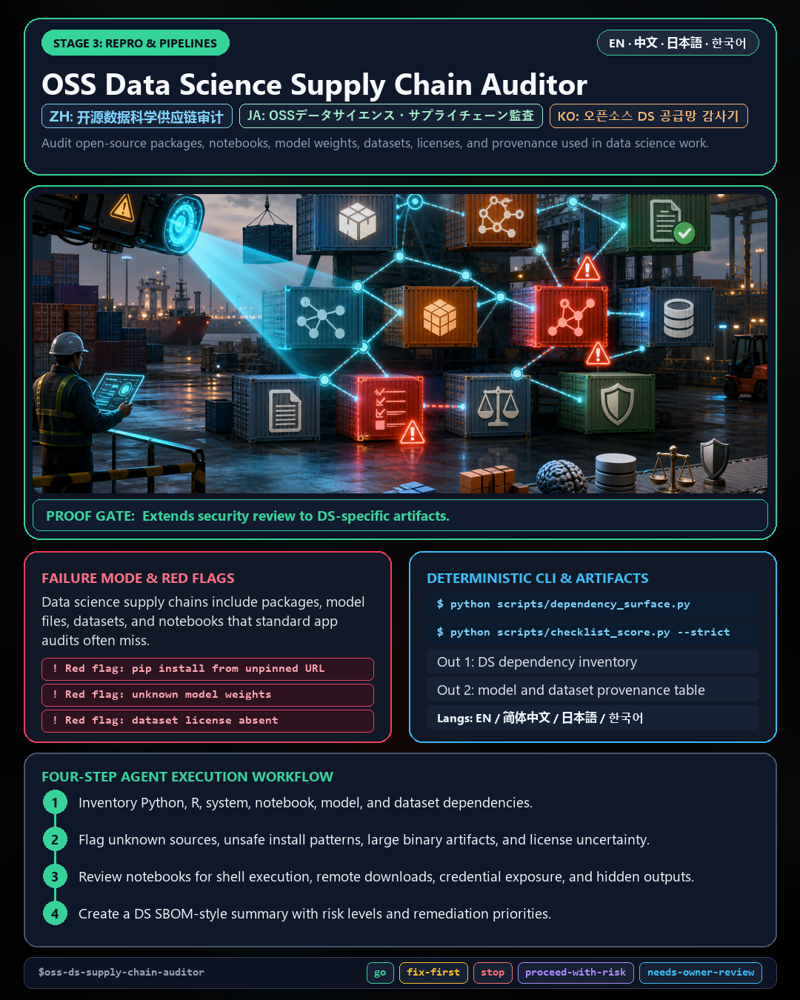

# OSS Data Science Supply Chain Auditor





## Executive Summary

**OSS Data Science Supply Chain Auditor** is a portable, provider-neutral data science agent skill designed to audit open-source packages, notebooks, model weights, datasets, licenses, and provenance used in data science work.

> **Core pain solved:** Data science supply chains include packages, model files, datasets, and notebooks that standard app audits often miss.

> **Proof callout:** Extends security review to DS-specific artifacts.

## Research-Informed Design Standard

This skill follows reproducible data science and portable agent-skill standards:

- **Cookiecutter Data Science**: immutable raw data, clear artifact layout, and repeatable command entrypoints.
- **Kedro**: explicit input/output data contracts and modular workflow boundaries.
- **MLflow**: traceable parameters, metrics, provenance hashes, and governance-ready evaluation records.
- **Anthropic & Open Agent Skills**: concise `SKILL.md` frontmatter, progressive disclosure via `references/`, and deterministic local scripts in `scripts/`.
- **CfRR Reproducible Research**: deterministic verification, explicit uncertainty, and zero hidden state.

## Problem It Solves

Data science supply chains include packages, model files, datasets, and notebooks that standard app audits often miss. Without a structured gate, teams routinely discover `pip install from unpinned URL` or `unknown model weights` only after engineering effort or executive credibility has already been spent.

## What This Skill Should Do

- Transform a vague request into an explicit OSS Data Science Supply Chain Auditor decision with named owner, evidence, assumptions, and action threshold.
- Inspect local artifacts first: data extracts, schemas, notebooks, SQL, pipeline configs, model reports, tickets, and prior decisions.
- Separate mechanical checks from expert judgment so another reviewer can reproduce what was checked and what was inferred.
- Classify findings as stop, fix-first, monitor, accepted risk, or owner decision instead of producing generic advice.
- Preserve raw evidence and never silently mutate data, notebooks, model artifacts, or production configs.
- Return a decision artifact that can be handed to a data scientist, ML engineer, governance reviewer, or stakeholder without hidden context.

## Required Inputs

- repo path
- environment files
- notebooks
- model artifact paths
- dataset sources
- license expectations

## Operating Workflow

1. Inventory Python, R, system, notebook, model, and dataset dependencies.
2. Flag unknown sources, unsafe install patterns, large binary artifacts, and license uncertainty.
3. Review notebooks for shell execution, remote downloads, credential exposure, and hidden outputs.
4. Create a DS SBOM-style summary with risk levels and remediation priorities.
5. Return a supply-chain risk report and minimum cleanup plan.

## Expected Outputs

- DS dependency inventory
- model and dataset provenance table
- license risk list
- notebook risk findings
- remediation plan

All outputs are delivered inside the eight-section decision contract: `Problem`, `Inputs`, `Checks performed`, `Findings`, `Decision`, `Risks`, `Next actions`, and `Artifacts`.

## Concrete Use Cases

- **Pre-commit readiness gate**: Run `scripts/dependency_surface.py` on `repo path` to produce a `DS dependency inventory` before approving engineering scope.
- **Adversarial review**: Challenge a proposed `go` recommendation when `pip install from unpinned URL` or `unknown model weights` is suspected in `environment files`.
- **Cross-team handoff**: Generate `model and dataset provenance table` and `remediation plan` so ML engineers, governance reviewers, or downstream agents can act without re-running discovery.
- **Regression audit**: Score completed review checklists with `scripts/checklist_score.py --strict` inside CI to prevent unverified artifacts from shipping.

## Red Flags

- pip install from unpinned URL
- unknown model weights
- dataset license absent
- notebook output leaks secrets
- native binary dependency unreviewed

## Agent And Provider Portability

- **Agent Runtimes**: OpenAI Codex, ChatGPT Agents, Anthropic Claude, Claude Code, Google Gemini, GitHub Copilot, Cursor, Windsurf, Goose, OpenCode, OpenHands, Gravity, LangGraph, CrewAI, AutoGen, LlamaIndex, Semantic Kernel, and local LLM agents.
- **Data & ML Providers**: Snowflake, BigQuery, Databricks, Postgres, dbt, Dagster, Airflow, Prefect, MLflow, DVC, Weights & Biases, SageMaker, Vertex AI, Azure ML, Great Expectations, Pandera, Evidently, Kedro, and local CSV/Parquet/JSON files.

See [references/agent-portability.md](references/agent-portability.md) and [references/provider-interop.md](references/provider-interop.md) for host-specific integration instructions.

## Included Files

- `SKILL.md`
- `README.md`
- `MANIFEST.json`
- `AGENTS.md`
- `agents/openai.yaml`
- `scripts/dependency_surface.py`
- `scripts/checklist_score.py`
- `scripts/quick_validate_skill.py`
- `references/multilingual-guide.md`: Native English, Simplified Chinese (简体中文), Japanese (日本語), and Korean (한국어) execution guide.
- `references/playbook.md`
- `references/acceptance-tests.md`
- `references/provider-interop.md`
- `references/agent-portability.md`
- `references/quality-rubric.md`
- `references/benchmark-plan.md`
- `references/research-grounding.md`
- `references/evidence-map.md`
- `references/infographic-spec.md`
- `tests/test_skill_contract.py`
- `tests/fixtures/clean.md`
- `tests/fixtures/messy.md`
- `tests/fixtures/adversarial.md`
- `assets/hero-shot.png`
- `assets/reddit-infographic.png`

## Validation

Run the deterministic smoke and contract suite from inside this skill directory:

```bash
python scripts/dependency_surface.py .
python scripts/quick_validate_skill.py . --strict
python tests/test_skill_contract.py .
```

## Visual Assets

- Hero shot (`1600x900`): [assets/hero-shot.png](assets/hero-shot.png) (`https://raw.githubusercontent.com/Emily2040/data-science-agent-skills/main/data-science-agent-skills/oss-ds-supply-chain-auditor/assets/hero-shot.png`)
- Reddit infographic (`1080x1350`): [assets/reddit-infographic.png](assets/reddit-infographic.png) (`https://raw.githubusercontent.com/Emily2040/data-science-agent-skills/main/data-science-agent-skills/oss-ds-supply-chain-auditor/assets/reddit-infographic.png`)
