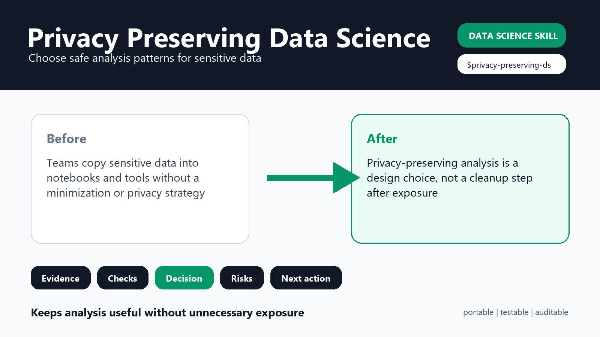
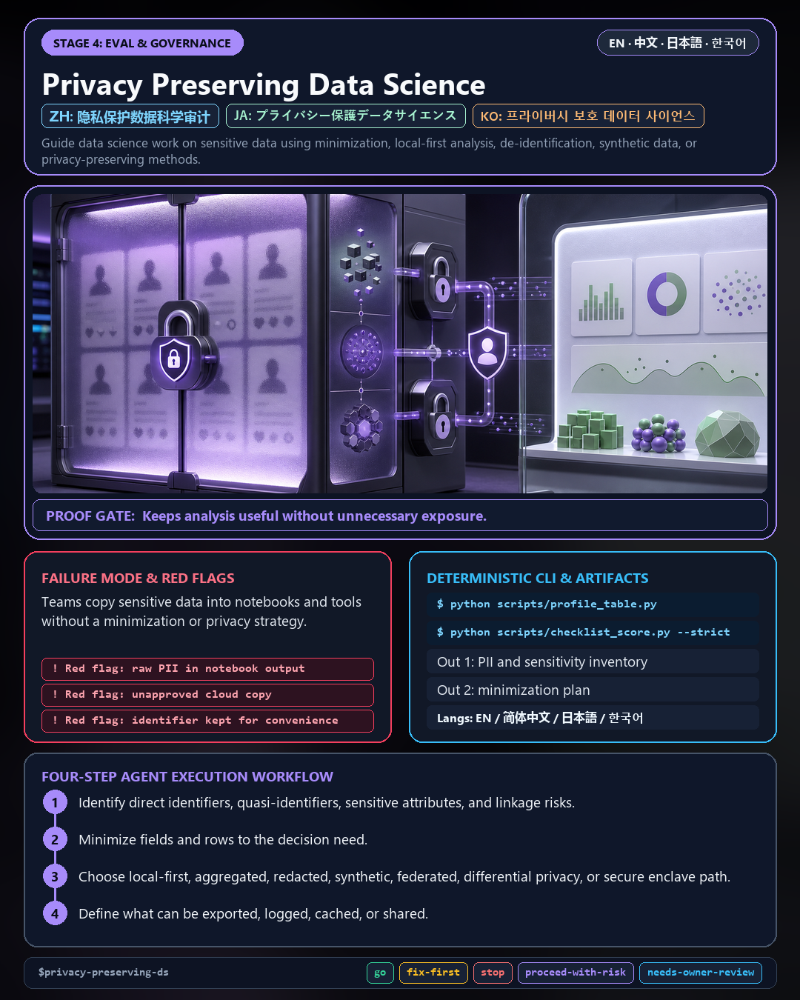

# Privacy Preserving Data Science





## Executive Summary

**Privacy Preserving Data Science** is a portable, provider-neutral data science agent skill designed to guide data science work on sensitive data using minimization, local-first analysis, de-identification, synthetic data, or privacy-preserving methods.

> **Core pain solved:** Teams copy sensitive data into notebooks and tools without a minimization or privacy strategy.

> **Proof callout:** Keeps analysis useful without unnecessary exposure.

## Research-Informed Design Standard

This skill follows reproducible data science and portable agent-skill standards:

- **Cookiecutter Data Science**: immutable raw data, clear artifact layout, and repeatable command entrypoints.
- **Kedro**: explicit input/output data contracts and modular workflow boundaries.
- **MLflow**: traceable parameters, metrics, provenance hashes, and governance-ready evaluation records.
- **Anthropic & Open Agent Skills**: concise `SKILL.md` frontmatter, progressive disclosure via `references/`, and deterministic local scripts in `scripts/`.
- **CfRR Reproducible Research**: deterministic verification, explicit uncertainty, and zero hidden state.

## Problem It Solves

Teams copy sensitive data into notebooks and tools without a minimization or privacy strategy. Without a structured gate, teams routinely discover `raw PII in notebook output` or `unapproved cloud copy` only after engineering effort or executive credibility has already been spent.

## What This Skill Should Do

- Transform a vague request into an explicit Privacy Preserving Data Science decision with named owner, evidence, assumptions, and action threshold.
- Inspect local artifacts first: data extracts, schemas, notebooks, SQL, pipeline configs, model reports, tickets, and prior decisions.
- Separate mechanical checks from expert judgment so another reviewer can reproduce what was checked and what was inferred.
- Classify findings as stop, fix-first, monitor, accepted risk, or owner decision instead of producing generic advice.
- Preserve raw evidence and never silently mutate data, notebooks, model artifacts, or production configs.
- Return a decision artifact that can be handed to a data scientist, ML engineer, governance reviewer, or stakeholder without hidden context.

## Required Inputs

- data schema or sample
- sensitive fields
- analysis goal
- approved environment
- sharing constraints

## Operating Workflow

1. Identify direct identifiers, quasi-identifiers, sensitive attributes, and linkage risks.
2. Minimize fields and rows to the decision need.
3. Choose local-first, aggregated, redacted, synthetic, federated, differential privacy, or secure enclave path.
4. Define what can be exported, logged, cached, or shared.
5. Return a privacy-safe analysis plan and residual risk note.

## Expected Outputs

- PII and sensitivity inventory
- minimization plan
- safe-compute recommendation
- export rules
- residual-risk note

All outputs are delivered inside the eight-section decision contract: `Problem`, `Inputs`, `Checks performed`, `Findings`, `Decision`, `Risks`, `Next actions`, and `Artifacts`.

## Concrete Use Cases

- **Pre-commit readiness gate**: Run `scripts/profile_table.py` on `data schema or sample` to produce a `PII and sensitivity inventory` before approving engineering scope.
- **Adversarial review**: Challenge a proposed `go` recommendation when `raw PII in notebook output` or `unapproved cloud copy` is suspected in `sensitive fields`.
- **Cross-team handoff**: Generate `minimization plan` and `residual-risk note` so ML engineers, governance reviewers, or downstream agents can act without re-running discovery.
- **Regression audit**: Score completed review checklists with `scripts/checklist_score.py --strict` inside CI to prevent unverified artifacts from shipping.

## Red Flags

- raw PII in notebook output
- unapproved cloud copy
- identifier kept for convenience
- synthetic data claimed risk-free
- exports not reviewed

## Agent And Provider Portability

- **Agent Runtimes**: OpenAI Codex, ChatGPT Agents, Anthropic Claude, Claude Code, Google Gemini, GitHub Copilot, Cursor, Windsurf, Goose, OpenCode, OpenHands, Gravity, LangGraph, CrewAI, AutoGen, LlamaIndex, Semantic Kernel, and local LLM agents.
- **Data & ML Providers**: Snowflake, BigQuery, Databricks, Postgres, dbt, Dagster, Airflow, Prefect, MLflow, DVC, Weights & Biases, SageMaker, Vertex AI, Azure ML, Great Expectations, Pandera, Evidently, Kedro, and local CSV/Parquet/JSON files.

See [references/agent-portability.md](references/agent-portability.md) and [references/provider-interop.md](references/provider-interop.md) for host-specific integration instructions.

## Included Files

- `SKILL.md`
- `README.md`
- `MANIFEST.json`
- `AGENTS.md`
- `agents/openai.yaml`
- `scripts/profile_table.py`
- `scripts/checklist_score.py`
- `scripts/quick_validate_skill.py`
- `references/multilingual-guide.md`: Native English, Simplified Chinese (简体中文), Japanese (日本語), and Korean (한국어) execution guide.
- `references/playbook.md`
- `references/acceptance-tests.md`
- `references/provider-interop.md`
- `references/agent-portability.md`
- `references/quality-rubric.md`
- `references/benchmark-plan.md`
- `references/research-grounding.md`
- `references/evidence-map.md`
- `references/infographic-spec.md`
- `tests/test_skill_contract.py`
- `tests/fixtures/clean.md`
- `tests/fixtures/messy.md`
- `tests/fixtures/adversarial.md`
- `assets/hero-shot.png`
- `assets/reddit-infographic.png`

## Validation

Run the deterministic smoke and contract suite from inside this skill directory:

```bash
python scripts/profile_table.py path/to/sensitive_extract.csv --max-rows 10000
python scripts/quick_validate_skill.py . --strict
python tests/test_skill_contract.py .
```

## Visual Assets

- Hero shot (`1600x900`): [assets/hero-shot.png](assets/hero-shot.png) (`https://raw.githubusercontent.com/Emily2040/data-science-agent-skills/main/data-science-agent-skills/privacy-preserving-ds/assets/hero-shot.png`)
- Reddit infographic (`1080x1350`): [assets/reddit-infographic.png](assets/reddit-infographic.png) (`https://raw.githubusercontent.com/Emily2040/data-science-agent-skills/main/data-science-agent-skills/privacy-preserving-ds/assets/reddit-infographic.png`)
